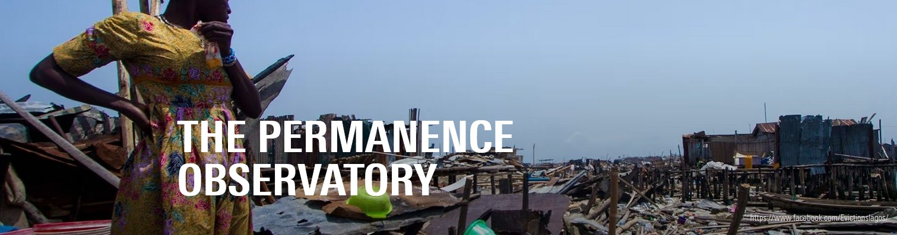

<p align="center">
  
</p>

<p align="center">
  Geospatial evidence and field documentation to defend informal settlement communities against forced eviction.
</p>

<p align="center">
  <a href="https://permanence-observatory.github.io"><b>Slum News Tracker</b></a>
  &nbsp;·&nbsp;
  <a href="https://www.permanenceobservatory.org/">permanenceobservatory.org</a>
</p>

<br>

## About

The **Permanence Observatory** is an interdisciplinary research initiative working at the intersection of technology, law and human rights. It combines satellite imagery, remote sensing, field surveys and residents' testimonies to document how long communities have occupied their land, and offers that documentation as evidence for their right to remain.

The Observatory works with communities at risk of eviction, choosing cases where spatial and legal documentation can make a decisive difference. Its findings are presented to courts, policymakers, advocacy groups, citizen tribunals and international bodies such as the United Nations and the European Court of Human Rights, and it aims for documentation rigorous enough to be admissible as legal evidence. It is funded by human rights and technology grants, academic partnerships and project-specific support, and all income is reinvested in its mission.

## Slum News Tracker

This repository hosts the **[Slum News Tracker](https://permanence-observatory.github.io)**, a daily map of news about informal settlements worldwide, built from the [GDELT Project](https://www.gdeltproject.org/).

A new version is being built and will replace the current one once its quality has been measured. Until then both run side by side, and the new version can be previewed at [/mapa/](https://permanence-observatory.github.io/mapa/).

| | Current version | New version (in development) |
|---|---|---|
| **Source** | GDELT DOC API: searches for 225 settlement names and keywords in four languages | Raw GDELT GKG 2.1 files: every article of the day, in English and 65 translated languages |
| **Selection** | Keywords and event categories | Pre-filter, then an open language model (qwen2.5:7b, run locally) reads each candidate |
| **Output** | Points by event type, with charts and filters | One point per story, with topics, removal stage and a daily history kept in `data/gkg/` |
| **Status** | In production | Under evaluation through blind human review |

Both run every day on GitHub Actions at no cost. The new collector keeps every candidate article, relevant or not, together with the model, prompt and pipeline version that classified it, so results can be audited and the history reclassified when the method changes. Method changes are listed in [`data/gkg/method_changes.json`](data/gkg/method_changes.json); [`ARCHITECTURE.md`](ARCHITECTURE.md) documents the design decisions.

### Repository structure

```
├── index.html            Current map (regenerated daily)
├── gdelt_version_v21.py  Current map script
├── mapa/                 New version of the map and its data
├── pipeline/             New collector and review tools
├── prototype/            Tests behind the pipeline's choices
├── data/gkg/             Daily history and summaries
├── .github/workflows/    Daily runs and manual experiments
└── ARCHITECTURE.md       Design notes
```

## Team

| Researcher | Affiliation |
|---|---|
| Jota Samper | University of Colorado Boulder |
| Julio Pedrassoli | University of São Paulo · Western Michigan University |
| Monika Kuffer | University of Twente |
| Raian Vargas Maretto | University of Twente |
| Angela Abascal | Public University of Navarra |
| Andrew Maki | Justice and Empowerment Initiatives (JEI) |
| Anthony Boanada-Fuchs | Institute for Housing and Urban Development Studies (IHS) |
| Malena Jaramillo Espinosa | Permanence Observatory |
| Juan Manuel D'Attoli | Permanence Observatory |

**PhD candidates, University of Twente:** Enzo Campomanes · Lorraine Trento Oliveira

## Partners

<p align="center">
  
  &nbsp;&nbsp;&nbsp;&nbsp;
  
  &nbsp;&nbsp;&nbsp;&nbsp;
  
  &nbsp;&nbsp;&nbsp;&nbsp;
  
</p>

## Contact and use

Questions about the Slum News Tracker: **Julio Pedrassoli**, jpedrassoli@usp.br.

The code and data are provided for research, advocacy and educational purposes. For collaboration or support, please get in touch through the contact above or the [Observatory's website](https://www.permanenceobservatory.org/).
